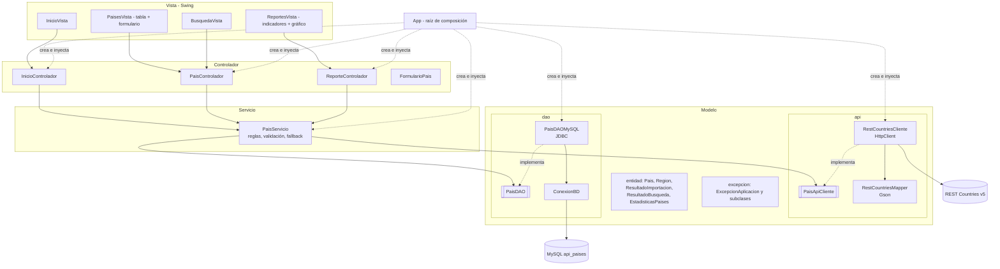
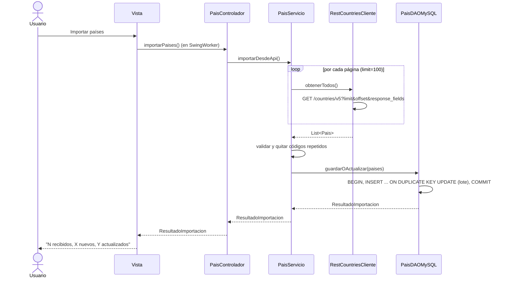
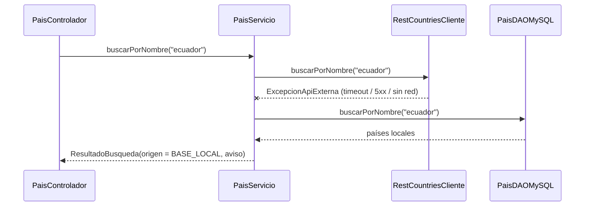

# Arquitectura — ApiPaisesMVC (Taller 2.1)

Aplicación de escritorio Java SE 21 (Maven) con el patrón **MVC** y una capa de
**servicio** entre los controladores y el modelo. Consume la API **REST** pública
REST Countries.

Paquetes (`ec.edu.monster`), todos al mismo nivel:

| Paquete | Contenido |
|---------|-----------|
| `vista` | Pantallas Swing (inicio, países, búsqueda, reportes) y componentes de la identidad "Azul" |
| `controlador` | `InicioControlador`, `PaisControlador`, `ReporteControlador`, `FormularioPais` |
| `servicio` | `PaisServicio`: reglas de negocio |
| `modelo` | `entidad`, `api` (REST Countries), `dao` (MySQL), `excepcion` |
| `config` | Lectura de `config.properties` |

## Vista de capas

## Responsabilidades

| Capa / clase | Responsabilidad | No debe |
|--------------|-----------------|---------|
| **Vista** | Mostrar datos, capturar acciones, avisar errores. Llama al controlador en segundo plano (`Tarea`, basada en `SwingWorker`). | Usar SQL, HTTP, el DAO o el servicio. |
| **Controladores** | Recibir la acción, convertir el texto del formulario (`FormularioPais`) a `Pais` y delegar en el servicio. | Tener reglas de negocio, SQL o JSON. |
| **PaisServicio** | Validar, evitar duplicados, orquestar API + BD, fallback, estadísticas. | Saber de HTTP, JSON o SQL. |
| **PaisApiCliente** (interfaz) | Contrato de la fuente externa. | — |
| **RestCountriesCliente** | HTTP con timeout, API key, paginación y traducción de errores HTTP. | Escribir en la BD. |
| **RestCountriesMapper** | JSON v5 → `Pais`; tolera capital o moneda faltante. | Hacer llamadas de red. |
| **PaisDAO** (interfaz) | Contrato de persistencia. | — |
| **PaisDAOMySQL** | SQL con `PreparedStatement`, try-with-resources, upsert en lote transaccional. | Contener reglas de negocio. |
| **ConexionBD** | Abrir conexiones con los datos de `config.properties`. | Tener credenciales en el código. |
| **App** | Leer la configuración, armar el grafo de objetos y abrir la ventana. | Contener lógica. |

## Diseño de la vista

La vista usa la paleta "Azul" del repositorio (`template.txt`): colores, Plus Jakarta
Sans, radios y espaciado en base 4. La navegación es una barra superior azul oscuro con
pestañas (Ctrl+1/2/3), el estado de MySQL y el regreso al inicio; el contenido de cada
sección ocupa todo el ancho.

| Pantalla | Patrón | Decisiones de usabilidad |
|----------|--------|--------------------------|
| Inicio | Foto del grupo + tarjeta | No hay usuarios, así que no se piden credenciales falsas. Se muestra el estado real de MySQL y de la clave de la API antes de entrar, con un enlace "Verificar" para comprobarlo de nuevo. |
| Países | Tabla paginada + panel lateral | Tabla a todo el ancho con 10, 25 o 50 filas por página; el filtro y el orden se aplican a **todas** las filas antes de cortar la página. Búsqueda sin tildes y chips de región con su cantidad. Editar o registrar abre un panel lateral sobre la tabla (Esc cierra; el foco no sale del panel). Confirmación antes de importar (sobrescribe ediciones), de eliminar (foco en "Cancelar") y de descartar cambios. Atajos Ctrl+F/N/S, Enter (editar), Supr (eliminar) y RePág/AvPág (cambiar de página). |
| Buscar en la API | Banda de búsqueda + tarjetas | Solo busca al pulsar (cada consulta gasta cuota); sugerencias de ejemplo; cada resultado indica si ya está guardado ("Guardar" o "Actualizar datos"); si la API falla avisa que los datos son locales. |
| Reportes | Indicadores + barras + ranking | Gráfico de una serie: un color, sin leyenda, valor en la punta, tooltip con porcentaje y descripción accesible; los empates se informan. Ranking de los 5 países más poblados (`ORDER BY poblacion DESC LIMIT 5`). |

Reglas comunes: un solo botón primario por pantalla; los estados se comunican con
icono y texto, no solo con color; toda operación lenta muestra un indicador de carga;
los números nunca se recortan y la tabla se desplaza en horizontal si no cabe.

## Secuencia: CU-01 Importar países

## Secuencia: CU-02 con API caída (fallback)

## Principios aplicados

| Principio | Dónde |
|-----------|-------|
| **SRP** | Cada clase tiene un motivo de cambio: el mapper cambia si cambia el JSON; el DAO, si cambia la tabla; el servicio, si cambian las reglas. |
| **OCP** | Otro proveedor de países = nueva clase que implemente `PaisApiCliente`; el servicio no cambia. |
| **LSP** | `PaisDAOMySQL` y el DAO en memoria de las pruebas son intercambiables. |
| **ISP** | `PaisApiCliente` solo tiene dos métodos. `ReporteControlador` está separado del CRUD. |
| **DIP** | `PaisServicio` depende de interfaces; `App` inyecta las implementaciones por constructor. |
| **Fail fast + mensajes claros** | Las excepciones tienen un mensaje para el usuario y conservan la causa técnica en el log. |
| **Inmutabilidad** | `Pais` y los resultados son `record`. |
| **Seguridad** | Las credenciales están fuera del código (`config.properties`, excluido de git), el usuario de MySQL tiene privilegios mínimos y se usan consultas parametrizadas. |

## Diferencias con el código del enunciado

| Enunciado | Esta solución | Motivo |
|-----------|---------------|--------|
| `https://restcountries.com/v3.1/all` | `https://api.restcountries.com/countries/v5` con API key y paginación | La v3.1 fue retirada: hoy responde con un aviso de deprecación. |
| `HttpURLConnection` sin timeout ni revisión del código HTTP | `HttpClient` con timeout y errores traducidos | Una API lenta o caída no debe congelar ni romper la aplicación. |
| `Conexion` con `root`/`12345` y `return null` | `ConexionBD` + `config.properties` y excepción | Sin credenciales en el código y sin errores `NullPointerException` posteriores. |
| `PaisDAO.guardar` sin cerrar recursos, una conexión por país | try-with-resources, lote y transacción | Evita fugas de conexiones; todo o nada. |
| Controlador que parsea JSON y crea `new PaisDAO()` | El mapper parsea; la dependencia se inyecta | Respeta SRP y DIP y permite probar el código. |
| Capital y moneda guardadas como `""` | Se extraen del JSON | Datos completos. |
| Tabla sin clave natural | `codigo` UNIQUE + upsert | Reimportar no duplica países. |
