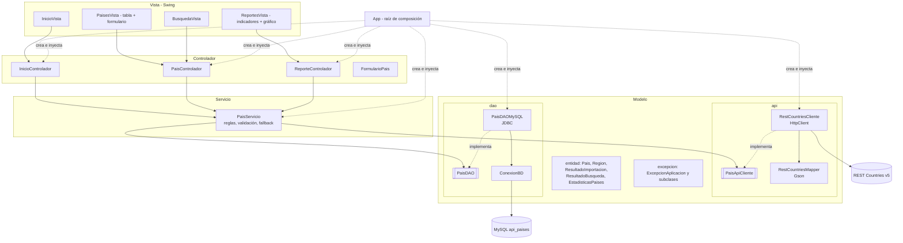
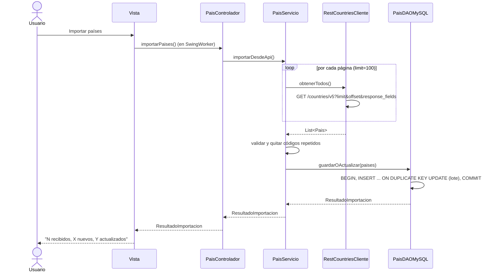
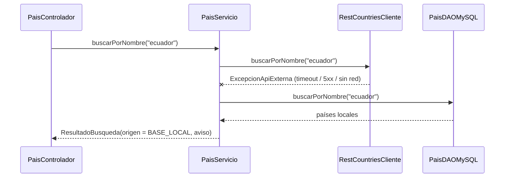

# Arquitectura de ApiPaisesMVC (Taller 2.1)

ApiPaisesMVC es una aplicación de escritorio en Java SE 21 (Maven) que consume la API pública
REST Countries. Sigue el patrón MVC y agrega una capa de servicio entre los controladores y el
modelo.

Todos los paquetes están al mismo nivel dentro de `ec.edu.monster`:

| Paquete | Contenido |
|---------|-----------|
| `vista` | Pantallas Swing (inicio, países, búsqueda, reportes) y componentes de la identidad "Azul" |
| `controlador` | `InicioControlador`, `PaisControlador`, `ReporteControlador`, `FormularioPais` |
| `servicio` | `PaisServicio`, con las reglas de negocio |
| `modelo` | `entidad`, `api` (REST Countries), `dao` (MySQL), `excepcion` |
| `config` | Lectura de `config.properties` |

## Vista de capas

## Responsabilidades

| Capa / clase | Responsabilidad | No debe |
|--------------|-----------------|---------|
| Vista | Mostrar datos, capturar acciones y avisar errores. Llama al controlador en segundo plano con `Tarea`, que usa `SwingWorker`. | Usar SQL, HTTP, el DAO o el servicio. |
| Controladores | Recibir la acción, convertir el texto del formulario (`FormularioPais`) en un `Pais` y delegar en el servicio. | Tener reglas de negocio, SQL o JSON. |
| PaisServicio | Validar, evitar duplicados, coordinar la API con la base, aplicar el fallback y calcular las estadísticas. | Saber de HTTP, JSON o SQL. |
| PaisApiCliente (interfaz) | Contrato de la fuente externa. | — |
| RestCountriesCliente | Hacer las peticiones HTTP con timeout, API key y paginación, y traducir los errores HTTP. | Escribir en la BD. |
| RestCountriesMapper | Convertir el JSON v5 en `Pais`. Acepta países sin capital o sin moneda. | Hacer llamadas de red. |
| PaisDAO (interfaz) | Contrato de persistencia. | — |
| PaisDAOMySQL | Ejecutar el SQL con `PreparedStatement` y try-with-resources, y hacer el upsert en lote dentro de una transacción. | Contener reglas de negocio. |
| ConexionBD | Abrir conexiones con los datos de `config.properties`. | Tener credenciales en el código. |
| App | Leer la configuración, armar el grafo de objetos y abrir la ventana. | Contener lógica. |

## Diseño de la vista

La vista usa la paleta "Azul" del repositorio (`template.txt`): sus colores, la fuente Plus Jakarta
Sans, los radios y el espaciado en base 4. Para navegar hay una barra superior azul oscuro con
pestañas (Ctrl+1/2/3), el estado de MySQL y un botón para volver al inicio. Cada sección usa todo el
ancho de la ventana.

| Pantalla | Patrón | Decisiones de usabilidad |
|----------|--------|--------------------------|
| Inicio | Foto del grupo + tarjeta | La aplicación no maneja usuarios, así que no pide credenciales que no protegerían nada. Antes de entrar muestra el estado real de MySQL y de la clave de la API, con un enlace "Verificar" para comprobarlo otra vez. |
| Países | Tabla paginada + panel lateral | La tabla ocupa todo el ancho y muestra 10, 25 o 50 filas por página. El filtro y el orden se aplican a todas las filas antes de cortar la página. La búsqueda ignora las tildes y los chips de región muestran cuántos países tiene cada una. Editar o registrar abre un panel lateral sobre la tabla: Esc lo cierra y el foco no sale de él. Se pide confirmación antes de importar (porque sobrescribe lo editado), de eliminar (con el foco en "Cancelar") y de descartar cambios. Atajos: Ctrl+F/N/S, Enter para editar, Supr para eliminar y RePág/AvPág para cambiar de página. |
| Buscar en la API | Banda de búsqueda + tarjetas | Solo busca al pulsar el botón, porque cada consulta gasta cuota. Ofrece búsquedas de ejemplo y cada resultado indica si ya está guardado ("Guardar" o "Actualizar datos"). Si la API falla, avisa que los datos son locales. |
| Reportes | Indicadores + barras + ranking | El gráfico es de una sola serie: un color, sin leyenda, con el valor en la punta, un tooltip con el porcentaje y una descripción para lectores de pantalla. Los empates se informan. El ranking muestra los 5 países más poblados (`ORDER BY poblacion DESC LIMIT 5`). |

En todas las pantallas hay un solo botón primario, los estados se indican con icono y texto (no
solo con color) y las operaciones lentas muestran un indicador de carga. Los números nunca se
recortan; si la tabla no cabe, se desplaza en horizontal.

## Secuencia: CU-01 Importar países

## Secuencia: CU-02 con la API caída (fallback)

## Principios aplicados

| Principio | Dónde |
|-----------|-------|
| SRP | Cada clase tiene un solo motivo de cambio: el mapper cambia si cambia el JSON, el DAO si cambia la tabla y el servicio si cambian las reglas. |
| OCP | Para usar otro proveedor de países basta una clase nueva que implemente `PaisApiCliente`; el servicio no cambia. |
| LSP | `PaisDAOMySQL` y el DAO en memoria de las pruebas son intercambiables. |
| ISP | `PaisApiCliente` tiene solo dos métodos y `ReporteControlador` está separado del CRUD. |
| DIP | `PaisServicio` depende de interfaces y `App` le inyecta las implementaciones por constructor. |
| Fallar pronto, con mensajes claros | Las excepciones llevan un mensaje para el usuario y guardan la causa técnica en el log. |
| Inmutabilidad | `Pais` y los resultados son `record`. |
| Seguridad | Las credenciales están fuera del código (en `config.properties`, que no se sube a git), el usuario de MySQL tiene los privilegios mínimos y todas las consultas son parametrizadas. |

## Diferencias con el código del enunciado

| Enunciado | Esta solución | Motivo |
|-----------|---------------|--------|
| `https://restcountries.com/v3.1/all` | `https://api.restcountries.com/countries/v5` con API key y paginación | La v3.1 fue retirada y hoy responde con un aviso de deprecación. |
| `HttpURLConnection` sin timeout ni revisión del código HTTP | `HttpClient` con timeout y errores traducidos | Una API lenta o caída no debe congelar ni romper la aplicación. |
| `Conexion` con `root`/`12345` y `return null` | `ConexionBD` + `config.properties` y excepción | No hay credenciales en el código ni `NullPointerException` más adelante. |
| `PaisDAO.guardar` sin cerrar recursos, una conexión por país | try-with-resources, lote y transacción | Evita fugas de conexiones y guarda todo o nada. |
| Controlador que parsea JSON y crea `new PaisDAO()` | El mapper parsea y la dependencia se inyecta | Cumple SRP y DIP, y el código se puede probar. |
| Capital y moneda guardadas como `""` | Se extraen del JSON | Se guardan los datos completos. |
| Tabla sin clave natural | `codigo` UNIQUE + upsert | Reimportar no duplica países. |
