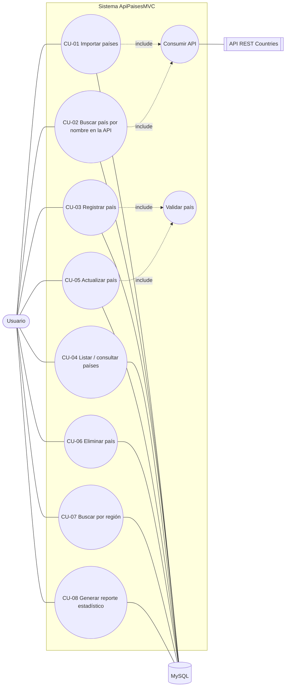

# Casos de uso de ApiPaisesMVC (Taller 2.1)

ApiPaisesMVC es una aplicación de escritorio en Java que consulta países en la API pública
REST Countries, los guarda en MySQL y permite gestionarlos.

## Actores

| Actor | Tipo | Descripción |
|-------|------|-------------|
| Usuario | Principal | Persona que usa la aplicación de escritorio. |
| API REST Countries | Secundario (sistema externo) | Proveedor de datos de países (v5, requiere API key). |
| Base de datos MySQL | Secundario (sistema) | Guarda los países en `api_paises.pais`. |

## Diagrama general

## Relación con las actividades del taller

| Caso de uso | Actividad del taller |
|-------------|----------------------|
| CU-01 | Base del taller (botón "Importar países") |
| CU-02 | Actividad 1: consulta de un país por nombre |
| CU-03 a CU-06 | Actividad 2: CRUD (crear, leer, actualizar, eliminar) |
| CU-04 | Actividad 3: mostrar los países en un JTable |
| CU-07 | Actividad 4: búsqueda por región |
| CU-08 | Actividad 5: reportes estadísticos |

## CU-01 Importar países desde la API

| | |
|---|---|
| Actor | Usuario |
| Precondición | La API key está configurada y MySQL está disponible. |
| Postcondición | La tabla `pais` tiene todos los países de la API, sin duplicados. |

#### Flujo principal
1. El usuario pulsa "Importar desde la API".
2. El sistema consulta la API página por página, con hasta 100 países en cada una.
3. El sistema convierte cada país del JSON y descarta los que llegan incompletos (sin nombre, código o región).
4. El sistema guarda los países en una sola transacción: inserta los nuevos y actualiza los que ya existen con el mismo código ISO.
5. El sistema muestra cuántos países recibió, cuántos son nuevos y cuántos actualizó.

#### Flujos alternos
- 2a. La API no responde, tarda demasiado o rechaza la clave: el sistema muestra el motivo y no modifica la base.
- 4a. Falla la base de datos: el sistema deshace la transacción y muestra el error.

## CU-02 Buscar país por nombre en la API

| | |
|---|---|
| Actor | Usuario |
| Precondición | Ninguna. |
| Postcondición | El usuario ve las coincidencias y, si lo decide, guarda una. |

#### Flujo principal
1. El usuario escribe un nombre (por ejemplo "ecuador") y pulsa "Buscar".
2. El sistema valida que el nombre no esté vacío.
3. El sistema consulta la API, que busca en el nombre común, el oficial, los alternativos y los nativos.
4. El sistema muestra las coincidencias e indica cuáles ya están guardadas.
5. Opcional: el usuario pulsa "Guardar" en un resultado. El sistema lo inserta o, si el código ya existe, lo actualiza.

#### Flujos alternos
- 2a. El nombre está vacío: el sistema pide escribirlo y no consulta la API.
- 3a. La API no está disponible: el sistema busca en la base local y avisa que esos datos son locales (fallback).
- 4a. No hay coincidencias: el sistema informa que no encontró países.

## CU-03 Registrar país

| | |
|---|---|
| Actor | Usuario |
| Precondición | MySQL está disponible. |
| Postcondición | El país queda guardado con un id nuevo. |

#### Flujo principal
1. El usuario pulsa "Nuevo país" y completa código, nombre, capital, región, población y moneda en el panel lateral.
2. El sistema valida los datos (incluye *Validar país*).
3. El sistema verifica que el código no exista.
4. El sistema guarda el país, cierra el panel y lo muestra resaltado en la lista.

#### Flujos alternos
- 2a. Hay datos no válidos: el sistema muestra todos los errores juntos.
- 3a. El código ya existe: el sistema informa el conflicto.

#### Validar país (include)
- Código: obligatorio, 3 letras (ISO alfa-3).
- Nombre: obligatorio.
- Región: una de África, América, Antártida, Asia, Europa u Oceanía.
- Población: número entero, no negativo.
- Nombre, capital y moneda: máximo 100 caracteres.

## CU-04 Listar y consultar países

| | |
|---|---|
| Actor | Usuario |
| Precondición | MySQL está disponible. |
| Postcondición | Ninguna (solo lectura). |

#### Flujo principal
1. El usuario abre la pantalla de países.
2. El sistema muestra los países ordenados por nombre en una tabla (JTable) paginada de 10 en 10.
3. El usuario cambia de página, elige cuántas filas ver (10, 25 o 50) u ordena por otra columna.
4. El usuario selecciona un país y ve su detalle en el panel lateral.

#### Flujos alternos
- 2a. No hay países: el sistema muestra un mensaje y sugiere importarlos.

## CU-05 Actualizar país

| | |
|---|---|
| Actor | Usuario |
| Precondición | El país existe. |
| Postcondición | El país tiene los datos nuevos. |

#### Flujo principal
1. El usuario selecciona un país y modifica sus datos.
2. El sistema valida los datos (incluye *Validar país*).
3. El sistema verifica que el código no pertenezca a otro país.
4. El sistema guarda los cambios.

#### Flujos alternos
- 2a. Hay datos no válidos: el sistema muestra los errores.
- 3a. El código es de otro país: el sistema informa el conflicto.
- 4a. El país ya no existe porque otro usuario lo borró: el sistema lo informa.

## CU-06 Eliminar país

| | |
|---|---|
| Actor | Usuario |
| Precondición | El país existe. |
| Postcondición | El país ya no está en la base. |

#### Flujo principal
1. El usuario selecciona un país y pulsa "Eliminar".
2. El sistema pide confirmación.
3. El usuario confirma y el sistema elimina el país.

#### Flujos alternos
- 3a. El usuario cancela: no se elimina nada.
- 3b. El país ya no existe: el sistema lo informa.

## CU-07 Buscar países por región

| | |
|---|---|
| Actor | Usuario |
| Precondición | MySQL está disponible. |
| Postcondición | Ninguna (solo lectura). |

#### Flujo principal
1. El usuario elige una región: América, Europa, Asia, África, Oceanía o Antártida.
2. El sistema muestra los países de esa región, ordenados por nombre.

#### Flujos alternos
- 1a. No eligió región: el sistema pide elegir una.
- 2a. No hay países en la región: el sistema muestra la lista vacía.

## CU-08 Generar reporte estadístico

| | |
|---|---|
| Actor | Usuario |
| Precondición | MySQL está disponible. |
| Postcondición | Ninguna (solo lectura). |

#### Flujo principal
1. El usuario abre "Reportes".
2. El sistema calcula con la base de datos:
   - el número de países por región, de mayor a menor;
   - los cinco países más poblados (el primero es el país más poblado);
   - la región con más países.
3. El sistema muestra el reporte.

#### Flujos alternos
- 2a. No hay países: el sistema indica que no hay datos para el reporte.
