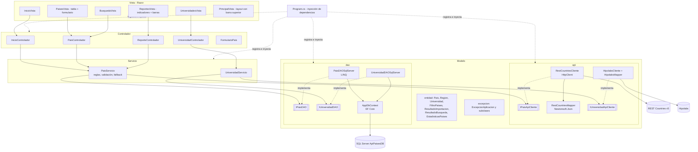
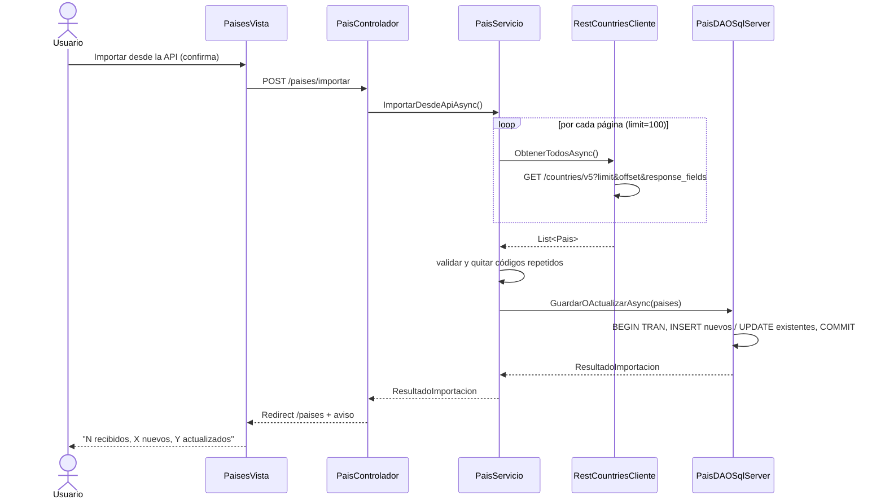
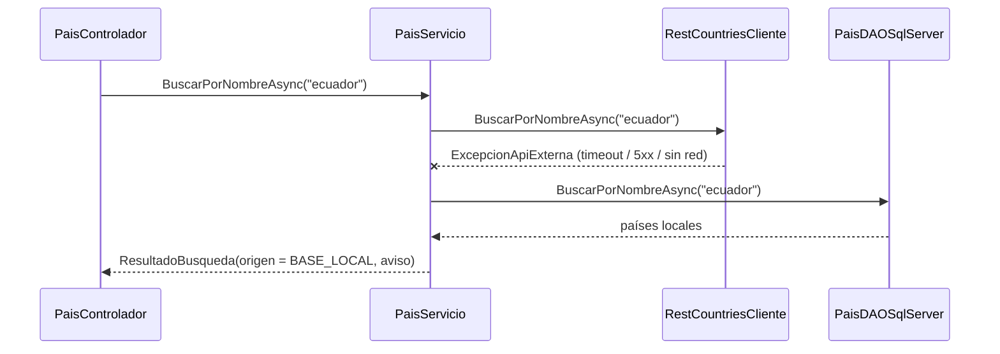

# Arquitectura de ApiPaisesMVC_SQLServer (Taller 2.2)

ApiPaisesMVC_SQLServer es una aplicación web ASP.NET Core MVC (.NET 8). Consume las API públicas
REST Countries y Hipolabs y guarda los datos en SQL Server con Entity Framework Core. Sigue el patrón
MVC y agrega una capa de servicio entre los controladores y el modelo. Es la versión .NET del
Taller 2.1 (Java), con los mismos paquetes, nombres de clases, reglas y mensajes.

Los espacios de nombres están todos al mismo nivel dentro de `ec.edu.monster`, en las carpetas
`ec/edu/monster/...`:

| Espacio de nombres | Contenido |
|--------------------|-----------|
| `vista` | Vistas Razor (inicio, países, búsqueda, reportes, universidades), componentes con la identidad "Azul", `Formato`, `Iconos` y `vista.modelo` (los datos que recibe cada vista, incluida la paginación) |
| `controlador` | `InicioControlador`, `PaisControlador`, `ReporteControlador`, `UniversidadControlador`, `FormularioPais`, `ControladorBase` |
| `servicio` | `PaisServicio` y `UniversidadServicio`, con las reglas de negocio |
| `modelo` | `entidad`, `api` (REST Countries y Hipolabs), `dao` (EF Core + SQL Server), `excepcion` |
| `config` | Lectura de `appsettings.json` |

`Program.cs` es la raíz de composición (el equivalente de `App.java`) y en `Migrations/` está la
migración `InitialCreate` de EF Core.

## Vista de capas

## Responsabilidades

| Capa / clase | Responsabilidad | No debe |
|--------------|-----------------|---------|
| Vista (Razor) | Mostrar datos, capturar acciones con formularios, avisar errores y pedir confirmación. | Usar SQL, HTTP, el DAO o el servicio. |
| Controladores | Recibir la petición HTTP, convertir el texto del formulario (`FormularioPais`) en un `Pais`, delegar en el servicio y elegir la vista. | Tener reglas de negocio, SQL o JSON. |
| PaisServicio | Validar, evitar duplicados, coordinar la API con la base, aplicar el fallback y calcular las estadísticas. | Saber de HTTP, JSON o SQL. |
| IPaisApiCliente (interfaz) | Contrato de la fuente externa. | — |
| RestCountriesCliente | Hacer las peticiones HTTP con timeout, API key y paginación, y traducir los errores HTTP. | Escribir en la BD. |
| RestCountriesMapper | Convertir el JSON v5 en `Pais`. Acepta países sin capital, subregión o moneda. | Hacer llamadas de red. |
| IPaisDAO (interfaz) | Contrato de persistencia. | — |
| PaisDAOSqlServer | Hacer las consultas con LINQ (SQL parametrizado), el upsert en una transacción y los reportes con `GroupBy`. | Contener reglas de negocio. |
| AppDbContext | Mapear las entidades a tablas, índices y restricciones. Es la base de las migraciones. | Tener credenciales en el código. |
| Program.cs | Leer la configuración y registrar las implementaciones en el contenedor de dependencias. | Contener lógica. |

## Diseño de la vista

La vista usa la identidad visual "Azul" del repositorio (`template.txt`), la misma de las pantallas
Swing del Taller 2.1 y de los clientes web .NET (`eureka.css`): sus colores, la fuente Plus Jakarta
Sans, los radios y el espaciado en base 4. Todo está en `wwwroot/css/paises.css`, sin Bootstrap ni
otras librerías. La estructura de las pantallas es la misma del rediseño en Java: una barra superior
azul oscuro con pestañas, el estado de SQL Server y un botón para volver al inicio, y cada sección
ocupa todo el ancho.

| Pantalla | Patrón | Decisiones de usabilidad |
|----------|--------|--------------------------|
| Inicio | Foto del grupo + tarjeta | La aplicación no maneja usuarios, así que no pide credenciales que no protegerían nada. Antes de entrar muestra el estado real de SQL Server y de la clave de la API, con un enlace "Verificar". |
| Países | Tabla paginada + panel lateral | La tabla ocupa todo el ancho y muestra 10, 25 o 50 filas por página (`?pagina=&tamano=`). Se puede ordenar por cualquier columna (`?orden=&dir=`) y el orden se aplica a todas las filas filtradas antes de cortar la página. Hay búsqueda por nombre, capital o región, y chips de región con la cantidad de países. Registrar (`/paises/nuevo`) y editar (`/paises/{id}`) abren un panel lateral sobre la tabla: Esc lo cierra y el foco no sale de él. Al guardar, el panel se cierra y la tabla abre la página donde quedó el país, resaltado. Se pide confirmación antes de importar, de eliminar (desde la fila o el panel, con el foco en "Cancelar") y de salir con cambios sin guardar. |
| Buscar en la API | Banda de búsqueda + tarjetas | Solo busca al pulsar el botón, porque cada consulta gasta cuota. Ofrece búsquedas de ejemplo y cada resultado indica si ya está guardado ("Guardar en SQL Server" o "Actualizar datos"). Si la API falla, avisa que los datos son locales. |
| Reportes | Indicadores + barras + ranking | Los gráficos son de una sola serie: un color, sin leyenda, con el valor en la punta y el porcentaje. Los empates se informan. El ranking muestra los 5 países más poblados (el primero responde el Reporte 2) y cada reporte tiene su consulta SQL equivalente. |
| Universidades | Importar + búsqueda + tabla paginada | El país por defecto es Ecuador. Se puede buscar por nombre, dominio o sitio web, y la búsqueda se combina con los chips por país. La tabla se pagina igual que la de países y los sitios web se abren en otra pestaña. |

En todas las pantallas hay un solo botón primario, los estados se indican con icono y texto (no
solo con color) y los botones muestran un indicador de carga mientras el servidor responde. Los
números nunca se recortan; si la tabla no cabe, se desplaza en horizontal. Después de cada POST la
aplicación redirige (Post-Redirect-Get), así recargar la página no repite la acción.

## Secuencia: CU-01 Importar países

## Secuencia: CU-02 con la API caída (fallback)

## Principios aplicados

| Principio | Dónde |
|-----------|-------|
| SRP | Cada clase tiene un solo motivo de cambio: el mapper cambia si cambia el JSON, el DAO si cambia la tabla, el servicio si cambian las reglas y la vista si cambia la pantalla. |
| OCP | Para usar otro proveedor de países basta una clase nueva que implemente `IPaisApiCliente`; el servicio no cambia. |
| LSP | `PaisDAOSqlServer` y el DAO en memoria de las pruebas son intercambiables. |
| ISP | `IPaisApiCliente` tiene solo dos métodos, `ReporteControlador` está separado del CRUD y universidades tiene sus propias interfaces. |
| DIP | Los controladores y servicios dependen de abstracciones, y `Program.cs` registra las implementaciones (`AddScoped`, `AddHttpClient`). |
| Fallar pronto, con mensajes claros | Las excepciones llevan un mensaje para el usuario y guardan la causa técnica en el log. |
| Seguridad | Consultas parametrizadas (LINQ), token antifalsificación en todos los POST, autenticación de Windows sin contraseñas en el código y enlaces externos con `rel="noopener"`. |

## Diferencias con el código del enunciado

| Enunciado | Esta solución | Motivo |
|-----------|---------------|--------|
| `https://restcountries.com/v3.1/all` | `https://api.restcountries.com/countries/v5` con API key y paginación | La v3.1 fue retirada y hoy responde con un aviso de deprecación. |
| Controlador con `new HttpClient()` que parsea el JSON y llama a `_context` | Controlador → `PaisServicio` → `IPaisApiCliente` / `IPaisDAO` | Cumple SRP y DIP, como piden las preguntas de reflexión, y el código se puede probar. |
| `PaisApiService` / `PaisRepository` | `RestCountriesCliente` / `PaisDAOSqlServer` en `ec.edu.monster` | Mantiene los nombres y paquetes del Taller 2.1 y de los demás clientes del grupo. |
| `pais.Moneda = "N/D"` | Se extrae la moneda principal del JSON | Se guardan los datos completos. |
| Tabla sin clave natural | `Codigo` UNIQUE + upsert | Reimportar no duplica países. |
| `Convert.ToInt64(item["population"])` sin validar | Mapper que tolera datos faltantes y validación en el servicio | Un dato faltante no rompe la importación. |
| Vistas con Bootstrap (`btn`, `table-bordered`) | Identidad "Azul" propia | El diseño es el mismo de los demás talleres del grupo. |
| Universidades: el enunciado solo indica la entidad | `Universidad` con índice único (país + nombre), pantalla propia, búsqueda y paginación | La actividad avanzada queda completa. |
