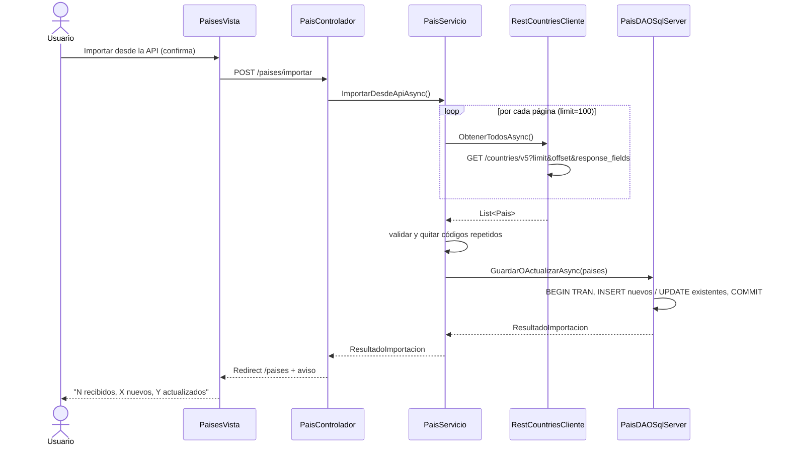
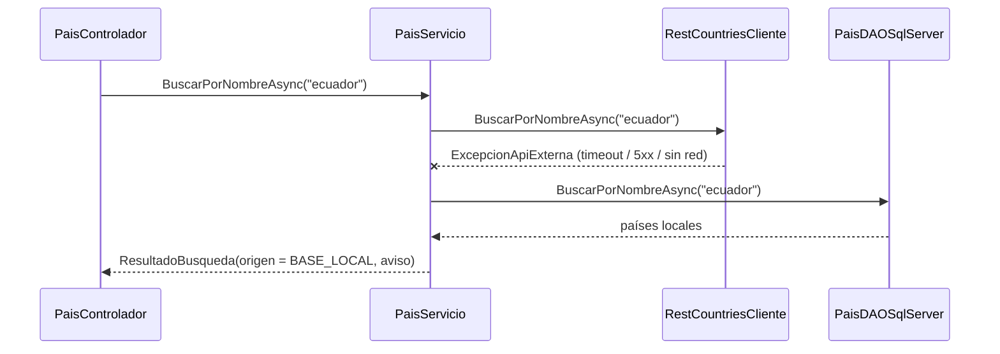

# Arquitectura — ApiPaisesMVC_SQLServer (Taller 2.2)

Aplicación web ASP.NET Core MVC (.NET 8) con el patrón **MVC** y una capa de **servicio** entre los
controladores y el modelo. Consume las API **REST** públicas REST Countries y Hipolabs, y guarda los
datos en **SQL Server** con **Entity Framework Core**. Es la versión .NET del Taller 2.1 (Java): mismos
paquetes, nombres de clases, reglas y mensajes.

Espacios de nombres (`ec.edu.monster`), todos al mismo nivel, en carpetas `ec/edu/monster/...`:

| Espacio de nombres | Contenido |
|--------------------|-----------|
| `vista` | Vistas Razor (inicio, países, búsqueda, reportes, universidades), componentes con la identidad "Azul", `Formato`, `Iconos` y `vista.modelo` (datos que cada vista recibe) |
| `controlador` | `InicioControlador`, `PaisControlador`, `ReporteControlador`, `UniversidadControlador`, `FormularioPais`, `ControladorBase` |
| `servicio` | `PaisServicio` y `UniversidadServicio`: reglas de negocio |
| `modelo` | `entidad`, `api` (REST Countries y Hipolabs), `dao` (EF Core + SQL Server), `excepcion` |
| `config` | Lectura de `appsettings.json` |

`Program.cs` es la raíz de composición (equivale a `App.java`) y `Migrations/` guarda la migración
`InitialCreate` de EF Core.

## Vista de capas

## Responsabilidades

| Capa / clase | Responsabilidad | No debe |
|--------------|-----------------|---------|
| **Vista** (Razor) | Mostrar datos, capturar acciones con formularios, avisar errores y pedir confirmación. | Usar SQL, HTTP, el DAO o el servicio. |
| **Controladores** | Recibir la petición HTTP, convertir el texto del formulario (`FormularioPais`) a `Pais`, delegar en el servicio y elegir la vista. | Tener reglas de negocio, SQL o JSON. |
| **PaisServicio** | Validar, evitar duplicados, orquestar API + BD, fallback, estadísticas. | Saber de HTTP, JSON o SQL. |
| **IPaisApiCliente** (interfaz) | Contrato de la fuente externa. | — |
| **RestCountriesCliente** | HTTP con timeout, API key, paginación y traducción de errores HTTP. | Escribir en la BD. |
| **RestCountriesMapper** | JSON v5 → `Pais`; tolera capital, subregión o moneda faltante. | Hacer llamadas de red. |
| **IPaisDAO** (interfaz) | Contrato de persistencia. | — |
| **PaisDAOSqlServer** | Consultas LINQ (SQL parametrizado), upsert en una transacción, reportes con `GroupBy`. | Contener reglas de negocio. |
| **AppDbContext** | Mapear entidades a tablas, índices y restricciones; base de las migraciones. | Tener credenciales en el código. |
| **Program.cs** | Leer la configuración y registrar las implementaciones en el contenedor de dependencias. | Contener lógica. |

## Diseño de la vista

La vista reutiliza la identidad visual "Azul" del repositorio (`template.txt`), la misma de las
pantallas Swing del Taller 2.1 y de los clientes web .NET (`eureka.css`): colores, Plus Jakarta Sans,
radios y espaciado en base 4, en `wwwroot/css/paises.css`. No usa Bootstrap ni librerías externas.

| Pantalla | Patrón | Decisiones de usabilidad |
|----------|--------|--------------------------|
| Inicio | Foto del grupo + tarjeta | No hay usuarios, así que no se piden credenciales falsas. Se muestra el estado real de SQL Server y de la clave de la API antes de entrar. |
| Países | Lista-detalle | Búsqueda por nombre, capital o región; filtros por región con su conteo; formulario siempre visible con los errores juntos; confirmación antes de importar (sobrescribe ediciones) y de eliminar (foco en "Cancelar"); aviso al salir con cambios sin guardar. |
| Buscar en la API | Búsqueda + resultados | Solo busca al pulsar (cada consulta gasta cuota); si la API falla avisa que los datos son locales. |
| Reportes | Indicadores + barras | Gráficos de una serie: un color, sin leyenda, valor en la punta, porcentaje en el título emergente; los empates se informan; se muestra la consulta SQL equivalente. |
| Universidades | Formulario + tabla | País por defecto Ecuador; filtros por país con su conteo; los sitios web se abren en otra pestaña. |

Reglas comunes: un solo botón primario por pantalla; los estados se comunican con icono y texto, no
solo con color; los botones muestran un indicador de carga mientras el servidor responde; los números
nunca se recortan y la tabla se desplaza en horizontal si no cabe. Después de cada POST se redirige
(Post-Redirect-Get) para que recargar la página no repita la acción.

## Secuencia: CU-01 Importar países

## Secuencia: CU-02 con API caída (fallback)

## Principios aplicados

| Principio | Dónde |
|-----------|-------|
| **SRP** | Cada clase tiene un motivo de cambio: el mapper cambia si cambia el JSON; el DAO, si cambia la tabla; el servicio, si cambian las reglas; la vista, si cambia la pantalla. |
| **OCP** | Otro proveedor de países = nueva clase que implemente `IPaisApiCliente`; el servicio no cambia. |
| **LSP** | `PaisDAOSqlServer` y el DAO en memoria de las pruebas son intercambiables. |
| **ISP** | `IPaisApiCliente` solo tiene dos métodos; `ReporteControlador` está separado del CRUD; universidades tiene sus propias interfaces. |
| **DIP** | Controladores y servicios dependen de abstracciones; `Program.cs` registra las implementaciones (`AddScoped`, `AddHttpClient`). |
| **Fail fast + mensajes claros** | Las excepciones tienen un mensaje para el usuario y conservan la causa técnica en el log. |
| **Seguridad** | Consultas parametrizadas (LINQ), token antifalsificación en todos los POST, autenticación de Windows sin contraseñas en el código y enlaces externos con `rel="noopener"`. |

## Diferencias con el código del enunciado

| Enunciado | Esta solución | Motivo |
|-----------|---------------|--------|
| `https://restcountries.com/v3.1/all` | `https://api.restcountries.com/countries/v5` con API key y paginación | La v3.1 fue retirada: hoy responde con un aviso de deprecación. |
| Controlador con `new HttpClient()` que parsea el JSON y llama a `_context` | Controlador → `PaisServicio` → `IPaisApiCliente` / `IPaisDAO` | Respeta SRP y DIP (como piden las preguntas de reflexión) y permite probar el código. |
| `PaisApiService` / `PaisRepository` | `RestCountriesCliente` / `PaisDAOSqlServer` en `ec.edu.monster` | Mismos nombres y paquetes que el Taller 2.1 y los demás clientes del grupo. |
| `pais.Moneda = "N/D"` | Se extrae la moneda principal del JSON | Datos completos. |
| Tabla sin clave natural | `Codigo` UNIQUE + upsert | Reimportar no duplica países. |
| `Convert.ToInt64(item["population"])` sin validar | Mapper tolerante y validación en el servicio | Un dato faltante no rompe la importación. |
| Vistas con Bootstrap (`btn`, `table-bordered`) | Identidad "Azul" propia | Diseño consistente con los demás talleres del grupo. |
| Universidades: solo se indica la entidad | `Universidad` con índice único (país + nombre) y pantalla propia | Actividad avanzada completa. |
