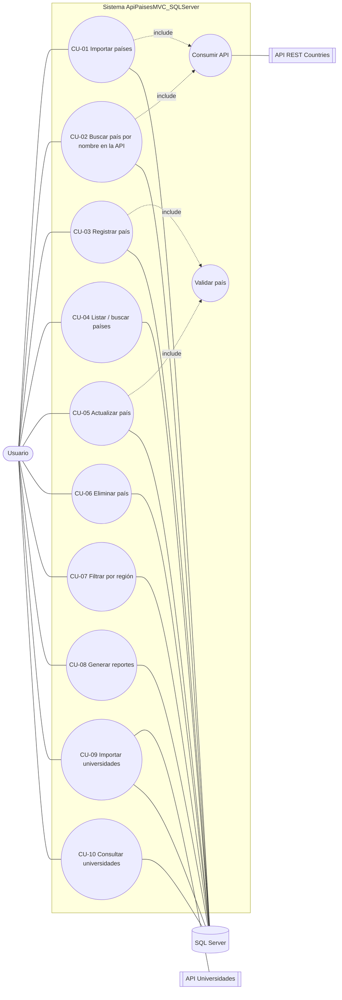

# Casos de uso — ApiPaisesMVC_SQLServer (Taller 2.2)

Aplicación web ASP.NET Core MVC que consulta países en la API pública REST Countries, los guarda en
SQL Server con Entity Framework Core y permite gestionarlos. Los casos CU-01 a CU-08 son los mismos del
Taller 2.1 (Java); CU-09 y CU-10 cubren la actividad avanzada.

## Actores

| Actor | Tipo | Descripción |
|-------|------|-------------|
| Usuario | Principal | Persona que opera la aplicación desde el navegador. |
| API REST Countries | Secundario (sistema externo) | Proveedor de datos de países (v5, requiere API key). |
| API de universidades (Hipolabs) | Secundario (sistema externo) | Proveedor de universidades por país. |
| Base de datos SQL Server | Secundario (sistema) | Almacena países y universidades (`ApiPaisesDB`). |

## Diagrama general

## Relación con las actividades del taller

| Caso de uso | Actividad del taller |
|-------------|----------------------|
| CU-01 | Base del taller (botón "Importar Información", secciones 14 a 16) |
| CU-02 | Actividad 1: consumir la API para un país específico |
| CU-03 a CU-06 | Actividad 2: CRUD completo (crear, leer, actualizar, eliminar) |
| CU-04 | Actividad 3: búsquedas por nombre, región y capital |
| CU-07 | Actividad 4: filtros dinámicos (América, Europa, Asia, África, Oceanía) |
| CU-08 | Actividad 5: reportes 1, 2 y 3 |
| CU-09 y CU-10 | Actividad avanzada: API de universidades y entidad `Universidad` |

---

## CU-01 Importar países desde la API

| | |
|---|---|
| **Actor** | Usuario |
| **Precondición** | La API key está configurada y SQL Server está disponible. |
| **Postcondición** | La tabla `Paises` tiene todos los países de la API, sin duplicados. |

**Flujo principal**
1. El usuario pulsa **Importar desde la API** y, si ya hay países, confirma en el diálogo.
2. El sistema consulta la API página por página (hasta 100 países por página).
3. El sistema convierte cada país del JSON (Newtonsoft.Json) y descarta los incompletos (sin nombre, código o región).
4. El sistema guarda los países en una sola transacción: inserta los nuevos y actualiza los que ya existen (mismo código ISO).
5. El sistema muestra cuántos países recibió, cuántos son nuevos y cuántos actualizó.

**Flujos alternos**
- 2a. La API no responde, tarda demasiado o rechaza la clave: el sistema muestra el motivo y no modifica la base.
- 4a. Falla la base de datos: el sistema deshace la transacción y muestra el error.

## CU-02 Buscar país por nombre en la API

| | |
|---|---|
| **Actor** | Usuario |
| **Precondición** | Ninguna. |
| **Postcondición** | El usuario ve las coincidencias y, si lo elige, una queda guardada. |

**Flujo principal**
1. El usuario escribe un nombre (p. ej. "ecuador") y pulsa **Buscar**.
2. El sistema valida que el nombre no esté vacío.
3. El sistema consulta la API (busca en nombre común, oficial, alternativos y nativos).
4. El sistema muestra las coincidencias con capital, región, subregión, población, área y moneda.
5. Opcional: el usuario pulsa **Guardar** en un resultado. El sistema lo inserta o, si el código ya existe, lo actualiza.

**Flujos alternos**
- 2a. El nombre está vacío: el sistema pide ingresarlo y no consulta la API.
- 3a. La API no está disponible: el sistema busca en la base local y avisa que los datos son locales (fallback).
- 4a. No hay coincidencias: el sistema informa que no encontró países.

## CU-03 Registrar país

| | |
|---|---|
| **Actor** | Usuario |
| **Precondición** | SQL Server está disponible. |
| **Postcondición** | El país queda guardado con un id nuevo. |

**Flujo principal**
1. El usuario completa código, nombre, capital, región, subregión, población, área y moneda.
2. El sistema valida los datos (incluye *Validar país*).
3. El sistema verifica que el código no exista.
4. El sistema guarda el país, lo muestra en la lista y deja el formulario en modo edición.

**Flujos alternos**
- 2a. Hay datos no válidos: el sistema muestra **todos** los errores juntos y conserva lo escrito.
- 3a. El código ya existe: el sistema informa el conflicto.

**Validar país (include)**
- Código: obligatorio, 3 letras (ISO alfa-3).
- Nombre: obligatorio.
- Región: una de África, América, Antártida, Asia, Europa u Oceanía.
- Población: número entero, no negativo (acepta separadores de miles).
- Área: opcional, número no negativo en km².
- Nombre, capital, subregión y moneda: máximo 100 caracteres.

## CU-04 Listar y buscar países

| | |
|---|---|
| **Actor** | Usuario |
| **Precondición** | SQL Server está disponible. |
| **Postcondición** | Ninguna (solo lectura). |

**Flujo principal**
1. El usuario abre la pantalla de países.
2. El sistema muestra todos los países ordenados por nombre en una tabla.
3. Opcional (Actividad 3): el usuario elige buscar por **Nombre**, **Capital** o **Región**, escribe un texto y pulsa **Buscar**.
4. El sistema muestra los países que coinciden (por nombre también acepta el código; por región, el nombre de la región o la subregión).
5. El usuario pulsa el nombre de un país y ve su detalle en el formulario.

**Flujos alternos**
- 2a. No hay países: el sistema muestra un estado vacío y sugiere importar.
- 4a. No hay coincidencias: el sistema lo informa y ofrece limpiar la búsqueda.

## CU-05 Actualizar país

| | |
|---|---|
| **Actor** | Usuario |
| **Precondición** | El país existe. |
| **Postcondición** | El país tiene los datos nuevos. |

**Flujo principal**
1. El usuario selecciona un país y modifica sus datos.
2. El sistema valida los datos (incluye *Validar país*).
3. El sistema verifica que el código no pertenezca a otro país.
4. El sistema guarda los cambios.

**Flujos alternos**
- 1a. El usuario sale con cambios sin guardar: el sistema pide confirmar que se descartan.
- 2a. Hay datos no válidos: el sistema muestra los errores.
- 3a. El código es de otro país: el sistema informa el conflicto.
- 4a. El país ya no existe (otro usuario lo borró): el sistema lo informa.

## CU-06 Eliminar país

| | |
|---|---|
| **Actor** | Usuario |
| **Precondición** | El país existe. |
| **Postcondición** | El país ya no está en la base. |

**Flujo principal**
1. El usuario selecciona un país y pulsa **Eliminar**.
2. El sistema pide confirmación mostrando código y nombre (foco en "Cancelar").
3. El usuario confirma y el sistema elimina el país.

**Flujos alternos**
- 3a. El usuario cancela: no se elimina nada.
- 3b. El país ya no existe: el sistema lo informa.

## CU-07 Filtrar países por región

| | |
|---|---|
| **Actor** | Usuario |
| **Precondición** | SQL Server está disponible. |
| **Postcondición** | Ninguna (solo lectura). |

**Flujo principal**
1. El sistema muestra un filtro por región con la cantidad de países guardados en cada una (Todas, África, América, Antártida, Asia, Europa, Oceanía).
2. El usuario elige una región.
3. El sistema muestra los países de esa región, ordenados por nombre. El filtro se combina con la búsqueda de CU-04.

**Flujos alternos**
- 3a. No hay países en la región: el sistema lo informa y ofrece ver todas las regiones.

## CU-08 Generar reportes

| | |
|---|---|
| **Actor** | Usuario |
| **Precondición** | SQL Server está disponible. |
| **Postcondición** | Ninguna (solo lectura). |

**Flujo principal**
1. El usuario abre **Reportes**.
2. El sistema calcula con la base de datos:
   - Reporte 1: número de países por región (de mayor a menor), con gráfico de barras.
   - Reporte 2: los cinco países más poblados (el primero es el país más poblado).
   - Reporte 3: promedio poblacional por región, con gráfico de barras.
   - Además: total de países y región con más países (informa empates).
3. El sistema muestra el reporte y la consulta SQL equivalente de cada uno.

**Flujos alternos**
- 2a. No hay países: el sistema indica que no hay datos para el reporte.

## CU-09 Importar universidades de un país

| | |
|---|---|
| **Actor** | Usuario |
| **Precondición** | SQL Server está disponible. |
| **Postcondición** | La tabla `Universidades` tiene las universidades del país, sin duplicados. |

**Flujo principal**
1. El usuario escribe un país en inglés (por defecto "Ecuador") y pulsa **Importar universidades**.
2. El sistema consulta `http://universities.hipolabs.com/search?country={país}`.
3. El sistema toma nombre, primer dominio, primera página web y país de cada universidad.
4. El sistema guarda en una transacción: inserta las nuevas y actualiza las que ya existen (mismo nombre y país).
5. El sistema muestra cuántas recibió, cuántas son nuevas y cuántas actualizó.

**Flujos alternos**
- 1a. El país está vacío: el sistema pide ingresarlo.
- 2a. La API no responde: el sistema muestra el motivo y no modifica la base.
- 2b. La API no tiene universidades para ese país: el sistema sugiere escribirlo en inglés.

## CU-10 Consultar universidades

| | |
|---|---|
| **Actor** | Usuario |
| **Precondición** | SQL Server está disponible. |
| **Postcondición** | Ninguna (solo lectura). |

**Flujo principal**
1. El usuario abre **Universidades**.
2. El sistema muestra las universidades guardadas (nombre, dominio, sitio web y país) y un filtro por país con su cantidad.
3. Opcional: el usuario elige un país y el sistema muestra solo sus universidades.

**Flujos alternos**
- 2a. No hay universidades: el sistema sugiere importarlas.
